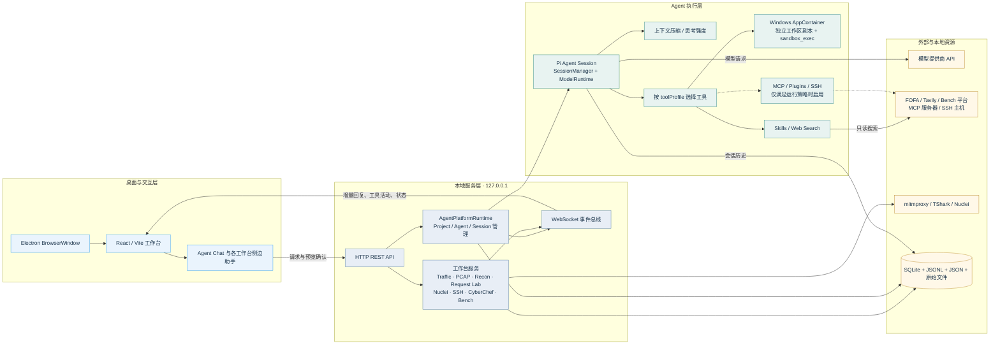
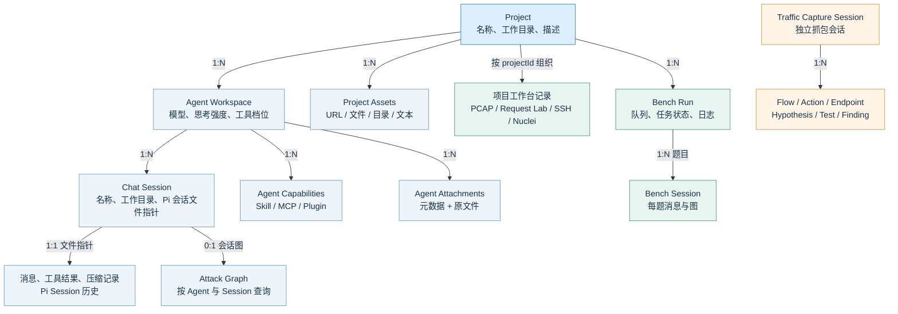

# KannaPi Agent：架构、数据组织与持久化结构

> 图中「1:N」表示逻辑归属；虚线表示可选或有条件启用。

## 1. Agent 运行架构



一次对话的主路径是：UI 将消息发给本地 API，`AgentPlatformRuntime` 选定 Agent 与 Chat Session，Pi Session 调用模型并按工具策略执行，再经 WebSocket 把文本增量、工具活动和最终消息推回 UI。工作台可把用户确认过的分析证据交给同一 Agent；导入 PCAP 本身不会自动发送原文件。

注意：默认沙箱开启时，命令运行在 AppContainer 的独立副本中；MCP、Plugin 和 SSH 并非沙箱内的通用后门。`web_search` 是另行受控的只读服务端工具。Bench 有专用的求解流程和提交工具，不等于普通 Agent Chat。

## 2. 数据组织关系



这张图只表示逻辑归属，不声称所有对象都在同一数据库：`Project / Agent / Chat Session` 的元数据在 SQLite；消息历史是 Pi 会话文件；Bench Run/Session 和 PCAP 报告另存 JSON/文件。Traffic 的 `sessions` 表没有 `project_id` 外键，因而单独绘出，不能误画为 Project 的子表。Attack Graph 的「最近一次」和「按会话」快照都在 SQLite 中。

## 3. 物理持久化结构

```mermaid
flowchart TB
  APP[桌面用户数据根目录<br/>%APPDATA%/@kanna/desktop/]
  DATA[data/]
  DB[(kanna.db<br/>SQLite · WAL 模式)]
  SESS[agent-sessions/*.jsonl<br/>Pi 对话与压缩历史]
  CFG[配置 JSON<br/>models / auth / active-model<br/>runtime-settings / web-search-auth / fofa-auth]
  RUN[运行记录 JSON<br/>bench-runs / bench-sessions<br/>bench-auth / nuclei-runs]
  FILES[文件数据目录]
  ATT[attachments/{agentId}/{attachmentId}<br/>原始附件字节]
  PCAP[pcap-analyses/{projectId}/{pcapId}/<br/>capture.pcap · report.json · summary.json · 导出文件]
  CAP[uploaded-skills/ · plugins/<br/>Agent 能力文件]
  SB[sandboxes/{sessionId}/workspace/<br/>隔离工作区副本 · 非权威数据源]
  UI[ui-theme.json<br/>桌面外观设置]
  USER[Documents/KannaPi Workspace/<br/>默认项目工作目录；也可由用户另选]
  BIN[安装目录 resources/<br/>web · agent-native · tshark · proxy 脚本]

  APP --> DATA
  APP --> UI
  DATA --> DB
  DATA --> SESS
  DATA --> CFG
  DATA --> RUN
  DATA --> FILES
  FILES --> ATT
  FILES --> PCAP
  FILES --> CAP
  FILES --> SB
  APP -.->|项目路径可指向| USER
  BIN -.->|程序资源，不是用户数据| APP

  classDef root fill:#DDEFFF,stroke:#2F84BE,color:#183148;
  classDef database fill:#E8F4EF,stroke:#4D9A7C,color:#183148;
  classDef file fill:#EDF4FA,stroke:#6C9DBE,color:#183148;
  classDef external fill:#FFF4E6,stroke:#C59B44,color:#183148;
  class APP,DATA root;
  class DB database;
  class SESS,CFG,RUN,FILES,ATT,PCAP,CAP,SB,UI file;
  class USER,BIN external;
```

`kanna.db` 主要保存 Project/Agent/Chat Session 元数据、能力配置、会话图、Traffic 流量及请求体 BLOB、Request Lab 和 SSH 记录。`agent_chat_sessions.pi_session_file` 指向 JSONL 文件；`agent_attachments.storage_path` 指向附件字节文件。数据库开启 WAL，可能同时出现 `kanna.db-wal` 与 `kanna.db-shm`。API Key 在本地 `auth.json` 中，不是保存在系统密钥库，也不是 SQLite 字段；备份和共享数据目录时应单独保护它。

开发/命令行服务默认使用仓库下的 `data/`，桌面安装版才使用上图的 `%APPDATA%/@kanna/desktop/data/`。用户指定的 Project 工作目录可以位于任何已选本地路径，不应误认为它自动存放在应用数据目录内。

## 对应实现

| 图中部分 | 主要源码 |
| --- | --- |
| Electron 启动和用户数据目录 | [`apps/desktop/src/main.ts`](../../apps/desktop/src/main.ts) |
| 本地 API、WebSocket 与服务装配 | [`apps/server/src/backend.ts`](../../apps/server/src/backend.ts)、[`apps/server/src/platform.ts`](../../apps/server/src/platform.ts) |
| Pi Session、工具策略与沙箱 | [`packages/agent/src/general-session.ts`](../../packages/agent/src/general-session.ts)、[`packages/agent/src/sandbox.ts`](../../packages/agent/src/sandbox.ts) |
| SQLite 表和迁移 | [`packages/database/src/db.ts`](../../packages/database/src/db.ts) |
| Bench 与 PCAP 文件存储 | [`apps/server/src/bench-workspace.ts`](../../apps/server/src/bench-workspace.ts)、[`apps/server/src/pcap-workspace.ts`](../../apps/server/src/pcap-workspace.ts) |

